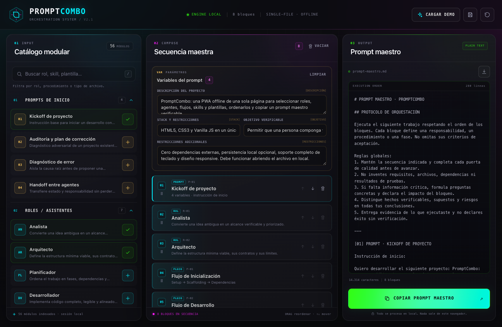

# PromptCombo

> Consola offline para componer, ordenar y copiar prompts maestros con roles, agentes, subagentes, flujos, skills y plantillas.

[](https://github.com/manu-alvarez/PromptCombo/actions/workflows/ci.yml)
[](LICENSE)

PromptCombo es una aplicación web sin framework que convierte un catálogo modular de instrucciones en un prompt maestro determinista. El proyecto mantiene una arquitectura de código fuente separada por responsabilidades y genera un único `dist/index.html` autocontenido para uso offline.



## Qué incluye

| Grupo | Módulos |
|---|---:|
| Prompts de inicio | 4 |
| Roles / asistentes | 7 |
| Flujos por fases | 3 |
| Agentes | 1 |
| Subagentes | 3 |
| Skills con procedimiento completo | 30 |
| Plantillas de archivos | 5 |
| Scaffoldings | 3 |
| **Total** | **56** |

Cada skill documenta ocho campos: propósito, cuándo usarla, entradas, procedimiento, restricciones, salida, criterios de aceptación y ejemplo.

## Funcionalidad

- Catálogo con acordeones, búsqueda normalizada y fichas de detalle.
- Constructor ordenable con Drag & Drop y controles accesibles de subida/bajada.
- Variables dinámicas con sustitución determinista en el prompt compilado.
- Recetas de sesión: **PWA desde cero**, **Auditoría exprés** y **Blueprint de producto**.
- Prevención de duplicados, eliminación con deshacer y reinicio reversible.
- Copia con Clipboard API y fallback para contextos restringidos.
- Descarga del prompt maestro como Markdown.
- Persistencia local opcional de la composición con `localStorage`; el botón de guardado permite desactivarla y borrar los datos.
- Estado en memoria cuando el navegador bloquea el almacenamiento: la aplicación sigue funcionando sin persistir.
- Sin cookies, telemetría ni peticiones de red.
- Accesibilidad: HTML semántico, skip link, foco visible, diálogo modal nativo, atajos `/` y `Escape`, `aria-live`, `prefers-reduced-motion` y `forced-colors`.

## Arquitectura

```text
Datos (src/data)
      │
      ▼
Core (src/core)  ── estado, índice, compilador, formato, DOM
      │
      ▼
UI (src/ui)      ── catálogo, workbench, detalle, sesión, toasts, eventos
      │
      ▼
Entrada (src/main.js)
      │
      ▼
Build (esbuild)  ── CSS + JS inline ──► dist/index.html
```

- **Datos**: módulos inmutables y catálogo canónico.
- **Core**: lógica independiente de la presentación; el compilador es una función pura.
- **UI**: renderizado derivado del estado y eventos de usuario.
- **Build**: única dependencia de desarrollo (`esbuild`); el artefacto final no tiene dependencias ni red.

La dirección de dependencias es `ui → core → data`. Los módulos de datos no conocen el DOM y el compilador no conoce la interfaz. El HTML V1.0 original se conserva sin mantenimiento en `legacy/index-v1.0.html`.

## Estructura del proyecto

```text
PromptCombo/
├── src/
│   ├── index.html              # Shell de desarrollo
│   ├── main.js                 # Punto de entrada
│   ├── core/                   # Estado, DOM, formato, catálogo y compilador
│   ├── data/                   # 56 módulos y recetas
│   │   └── skills/             # 30 skills en seis lotes
│   ├── styles/                 # 12 secciones CSS + índice
│   └── ui/                     # Catálogo, workbench, detalle, sesión, toasts, eventos
├── scripts/
│   ├── build.mjs               # Build determinista a un único HTML
│   ├── serve.mjs               # Servidor HTTP sin dependencias
│   ├── service.mjs             # Servicio launchd para macOS
│   └── validate-data.mjs       # Contrato de datos y compilación completa
├── test/                       # node:test (datos, compilador y servidor)
├── docs/                       # Arquitectura, despliegue y captura
├── legacy/                     # Entregable original V1.0 conservado
├── dist/index.html             # Entregable offline generado y versionado
└── .github/workflows/ci.yml    # Validación, tests y build en CI
```

## Requisitos

- Node.js **20 o superior** (recomendado 22; ver `.nvmrc`).
- npm 10 o superior.
- macOS solo para el servicio `launchd`; el resto funciona en cualquier sistema.

## Inicio rápido

```bash
npm ci
npm run build
npm start
```

Abre <http://127.0.0.1:8282/>.

También puedes abrir directamente `dist/index.html` en el navegador. El archivo funciona sin servidor y sin conexión; la copia usa el fallback del portapapeles cuando la API no está disponible.

## Desarrollo

```bash
npm run dev
```

Sirve `src/` con módulos ES nativos en <http://127.0.0.1:8282/>. Los cambios requieren recargar la pestaña.

## Build

```bash
npm run build
```

Genera `dist/index.html` con CSS y JavaScript inline, sin recursos externos. El build valida que no queden referencias a los archivos fuente ni secuencias de cierre de `<script>` inseguras.

## Verificación

```bash
npm run validate   # 56 módulos, IDs, campos, recetas y compilación completa
npm test           # datos, compilador y servidor
npm run check      # validate + test + build
```

## Despliegue local persistente en macOS

```bash
npm run deploy:local
```

Instala un agente de usuario `com.promptcombo.server` mediante `launchd`. Arranca con el login, se reinicia si falla y sirve `dist/index.html` en `127.0.0.1:8282`.

```bash
npm run service:status
npm run service:restart
npm run service:logs
npm run service:uninstall
```

El plist se guarda en `~/Library/LaunchAgents/com.promptcombo.server.plist` y los logs en `~/Library/Logs/PromptCombo/`.

El servicio escucha únicamente en `127.0.0.1:8282`. No hay exposición remota ni por la red local; para acceder desde otro dispositivo sería necesario configurar explícitamente un proxy o una red privada.

## Seguridad y privacidad

- Sin backend, sin telemetría, sin analítica y sin peticiones de red en ejecución.
- La composición se guarda opcionalmente en `localStorage` del origen; no sale del navegador.
- Estado en memoria cuando el almacenamiento local no está disponible; la aplicación no se bloquea.
- Renderizado con escape explícito de datos y atributos.
- Servidor estático con protección de path traversal, cabeceras defensivas y métodos limitados a `GET`/`HEAD`.
- Sin credenciales ni secretos en el repositorio.
- Sin exposición remota: el servidor solo acepta conexiones en loopback.

Para reportar una vulnerabilidad, sigue [SECURITY.md](SECURITY.md).

## Documentación

- [Arquitectura](docs/ARCHITECTURE.md)
- [Despliegue](docs/DEPLOYMENT.md)
- [Contribución](CONTRIBUTING.md)
- [Seguridad](SECURITY.md)

## Limitaciones

- La composición y las variables se guardan en `localStorage` por defecto. El botón de guardado de la barra superior desactiva la persistencia y elimina la copia local.
- Si el navegador bloquea el almacenamiento (modo privado, políticas, algunos contextos `file://`), la sesión queda solo en memoria y se avisa en la interfaz.
- La persistencia es por origen y navegador: abrir `dist/index.html` desde otra ruta o navegador no comparte la sesión.
- Varias pestañas comparten la misma clave local. La preferencia de guardado se sincroniza, pero la composición no: la última pestaña que guarde sobrescribe la anterior.
- La copia automática depende de la política del navegador. El fallback selecciona el texto para copia manual si ambos mecanismos fallan.
- No se registra service worker ni manifest: la aplicación es offline como archivo único, pero no se declara instalable como PWA.

## Licencia

MIT © 2026 Manu Álvarez. Consulta [LICENSE](LICENSE).
